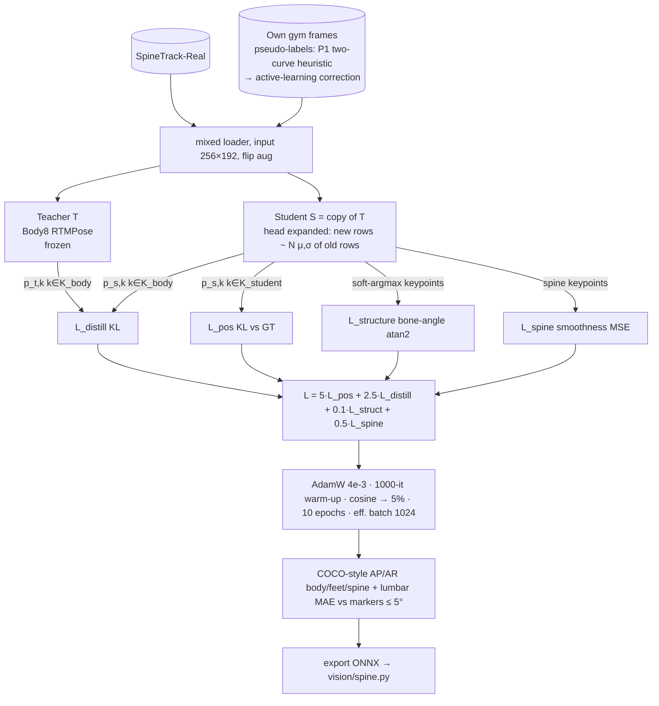
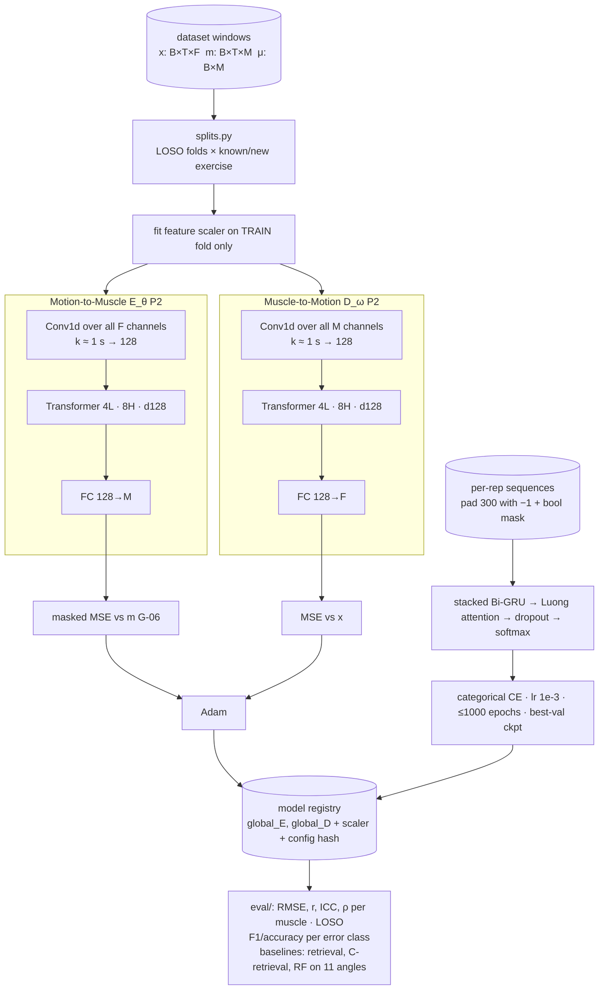
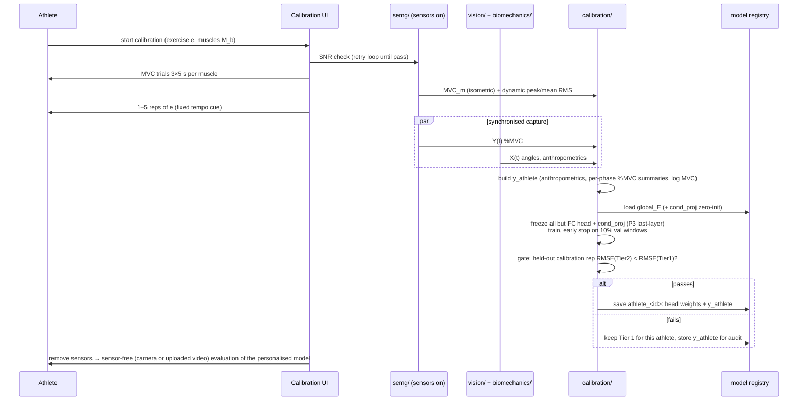

# MyoMotion — Architecture and Pipelines

_v1.0 (2026-11-15). Method details and citations live in `docs/METHODOLOGY_SPEC.md` (§ numbers below refer to it). Gap IDs `[G-nn]` refer to `docs/GAP_ANALYSIS.md`._

---

## ARCH-0. Module map

```
                 ┌──────────────────────────── src/myomotion/ ────────────────────────────┐
 camera ───────► │ vision/        detector.py (YOLOv5s)  pose.py (MediaPipe Tasks)          │
                 │                spine.py (SpinePose + heuristic fallback)  bridge.py [G-01] │
                 │                normalize.py (world-landmark root/scale) [G-02]             │
                 │ biomechanics/  landmarks.py geometry.py filters.py (+KeypointSmoother) [G-17]│
                 │                spine_proxy.py [G-24]  deadlift_angles.py  rep_segmenter.py [G-26]│
                 │                deadlift_rules.py [G-23]  deadlift_pipeline.py  synthetic.py │
 Arduino ──────► │ semg/          acquisition.py  dsp.py (notch+BPF+rect+window)  features.py │
 (serial)        │                mvc.py  fatigue.py  quality.py                              │
                 │ sync/          clock.py  ringbuffer.py  align.py  led_sync.py [G-03]       │
                 │ models/        motion2muscle.py (E_θ)  muscle2motion.py (D_ω)              │
                 │                form_classifier.py (Bi-GRU+Luong)  fusion/mct.py (P4, opt.) │
                 │                spinepose_train/ (P1 student, optional)  ssl/ (P5, opt.)    │
                 │ calibration/   mvc_session.py  athlete_profile.py  finetune.py (P3)        │
                 │ coaching/      cue_engine.py (hysteresis) [G-04]  correction.py (P6+P2)    │
                 │                overlay.py  tts.py                                          │
                 │ data/          schema.py  dataset.py (windows, masks)  splits.py (LOSO)    │
                 │ eval/          metrics.py (RMSE, r, ICC, ρ, AP, F1)  reports.py            │
                 └────────────────────────────────────────────────────────────────────────────┘
 configs/  (YAML: exercises/, dsp/, models/, splits/)      scripts/  (thin CLI entry points)
```

Dependency direction (enforced in review): `vision, semg → sync → data → models → calibration → coaching`. `biomechanics` depends only on numpy. **Nothing in `models/` imports `cv2` or serial libraries.**

---

## ARCH-1. Offline dataset collection and timestamp synchronisation

```mermaid
flowchart LR
  subgraph HW[Data-collection rig]
    E[Electrodes SENIAM sites<br/>3 muscles per block] --> AFE[AD8226 / MyoWare front-end]
    AFE --> ARD[Arduino Uno<br/>timer ISR @ fs, 3 ch<br/>sample counter n]
    ARD -- binary frames<br/>sync word · n · ch0..2 · crc --> SER[Serial ≥250k baud]
    ARD -- GPIO --> LED[Sync LED + beep]
    CAM[Camera 30–60 fps<br/>side or front view per exercise]
  end
  subgraph HOST[Laptop - on battery or USB isolator]
    SER --> RX[semg reader thread<br/>t_host = monotonic_ns at read]
    CAM --> FG[frame grabber thread<br/>t_host = monotonic_ns at grab]
    RX --> RB1[(sEMG ring buffer)]
    FG --> RB2[(frame ring buffer)]
    RB1 --> CLK[clock.py<br/>robust linear fit n → t_host<br/>offset + drift]
    LED -. seen in video .-> LEDDET[led_sync.py<br/>LED onset frame]
    LED -. GPIO edge in stream .-> CLK
    CLK --> ALN[align.py]
    LEDDET --> ALN
    RB2 --> W1[video.mp4 + frames.parquet]
    ALN --> W2[semg_raw.parquet / semg_env.parquet]
  end
  W1 --> OFF[Offline processing]
  W2 --> OFF
  OFF --> P1[vision: YOLO→MediaPipe→SpinePose→bridge]
  P1 --> P2[biomechanics: angles, phases → X t]
  OFF --> P3[semg: DSP → envelope → %MVC → Y t, features]
  P2 --> GRID[resample to model grid 10 Hz]
  P3 --> GRID
  GRID --> DS[(dataset: windows T=30, masks, meta)]
```



**Session protocol** (per participant, per block):

1. Skin prep, electrodes on, **SNR check** (rest vs light contraction). Reposition if below threshold (`semg/quality.py`).
2. Rest baseline 10 s → **MVC trials** 3 × 5 s per muscle (§3.4). Redo every session.
3. LED/beep sync pulse (start) → exercise sets with posture variations (randomised order, constant load and tempo, rest) → LED/beep sync pulse (end).
4. Two sync pulses give **offset and drift**. Acceptance: residual ≤ 33 ms (SRS).

**On-disk layout** (`data/raw/<subject_id>/<session_id>/`):

```
meta.json          subject (pseudonymous id), anthropometrics, exercise, block muscles, electrode sites,
                   semg_mode {raw|envelope}, fs, gain setting, camera view, fps, mains_hz
video.mp4          original capture (never re-encoded in place)
frames.parquet     frame_idx, t_host_ns, t_aligned_s
semg_raw.parquet   n, t_aligned_s, ch0..ch2   (raw mode)   | semg_env.parquet (envelope mode)
mvc.json           per-muscle MVC (isometric) + dynamic peak/mean RMS (P7)
sync.json          LED onsets (video + stream), fitted offset/drift, residuals
labels/            phases.parquet, form_labels.json (per rep), variation.json
```

Processed (`data/processed/<version>/`): `X.parquet` (grid features), `Y.parquet` (%MVC, NaN where not measured), `mask.parquet`, `windows.parquet` (subject, exercise, block, start, rep ids), `features18.parquet` (raw mode).

---

## ARCH-2. Stage 1 training — spine-extended pose student (optional; [P1])

Default path: **no training**. Use a released SpinePose checkpoint, validated on our marker frames. Train only to (a) adapt to gym imagery or (b) distil a smaller mobile student.



---

## ARCH-3. Stage 2 training — motion↔muscle, form classifier



Optional Phase-2 branches: [P5] CVCSPC/MD self-supervised pretraining on unlabelled gym video (never including test subjects), and [P4] MCT fusion if an RGB branch is added.

---

## ARCH-4. Athlete calibration (Tier 2) — research / FYP-evaluation protocol only

> **D-01 (resolved 2026-11-15, wording corrected 2026-11-18):** the released app is sensor-free (live camera or uploaded video; no sEMG). This flow is run by the team, with sEMG on, on consenting test participants, to evaluate whether personalisation helps. It is not an app feature. The last step ("camera-only coaching") is how the personalised model is then *evaluated*.



---

## ARCH-5. Real-time inference loop

```
 Thread A: capture            Thread B: perception (per frame)                   Thread C: models (10 Hz tick)
 ─────────────────            ────────────────────────────────                   ──────────────────────────────
 cv2 grab → (t_ns, frame) ──► YOLOv5s every k frames, tracker in between ──┐
   frame ring buffer           person ROI ─► MediaPipe (VIDEO mode, ts ms) │
   (drop oldest)               ROI ─► SpinePose (if budget) │ heuristic    │
                               bridge [G-01] ─► 33+9 regional skeleton     │
                               angles + filters ─► X(t) ring buffer (3 s) ─┼─► every 100 ms: last T=30 grid samples
                               phase state machine ─► rep events ──────────┼─►   E_θ(x; y_athlete?) → Ŷ (latest step)
                                                                            │   fatigue (calibration sessions only)
                               P8 rules each frame ─► safety faults ───────┤
                                                                            │ on rep complete:
                                                                            │   Bi-GRU form class (whole rep)
                                                                            │   P2 edit → D_ω → P8 veto → P6 fit
                                                                            ▼
                               Thread D: coaching  cue_engine (hysteresis, priority, cooldown) → overlay + TTS
```

**Latency budget (live target ≤ 33 ms/frame, SRS).** Measure these figures, never assume them. Report p50/p95 in `eval/reports.py`.

| Stage | Policy |
|---|---|
| YOLOv5s | run every *k* frames (start k = 5), track the ROI between runs |
| MediaPipe | `heavy` offline; `full`/`lite` live if over budget |
| SpinePose | SpinePose-s (≈0.72 GFLOPs [P1]); if over budget, run at 10 Hz and interpolate, or fall back (flagged) |
| E_θ | 10 Hz tick on 30-step window (tiny model) |
| Bi-GRU, D_ω | once per rep, off the frame path |

**Live-mode causality [G-07].** E_θ only ever sees the **past** 3 s window. Its unmasked attention is causal with respect to the future. The newest step has no right context and is the noisiest, so live output = mean of the last 3 steps' predictions for *t−2..t*, with a reported 200 ms display lag. Offline/upload mode runs centred windows.

**Failure handling.** No person for > 1 s → warn and pause rep logic (tracker `TRACKING_LOSS_TIMEOUT_S`). Spine source = heuristic → disable lumbar/pelvic rules and show "spine estimate unavailable". sEMG disconnect (calibration only) → recover within 2 s (SRS) or abort calibration.

---

## ARCH-6. Interfaces (contracts between modules)

```python
# vision/bridge.py
@dataclass(frozen=True)
class Skeleton:
    t_s: float                       # aligned timestamp, seconds
    body2d: np.ndarray               # [33, 3]  x_px, y_px, visibility   (MediaPipe)
    body3d: np.ndarray               # [33, 3]  world metres, hip-centred (MediaPipe)
    spine2d: np.ndarray | None       # [9, 3]   x_px, y_px, score  order = SPINE_LABELS
    spine_source: Literal["spinepose", "heuristic", "none"]
    image_wh: tuple[int, int]

SPINE_LABELS = ("C1", "C4", "C7", "T3", "T8", "L1", "L3", "L5", "SACRUM")

# biomechanics/angles.py
def compute_features(sk: Skeleton, view: Literal["side", "front"]) -> dict[str, float]  # NaN if unreliable

# semg/dsp.py
def process_raw(x: np.ndarray, fs: float, cfg: DSPConfig) -> Envelope      # x: [N, C]
# models/motion2muscle.py
class MotionToMuscle(nn.Module):
    def forward(self, x: Tensor, cond: Tensor | None = None) -> Tensor:
        """x: [B, T, F] → m_hat: [B, T, M]; cond: [B, C_cond] (tiled internally)"""
```

---

## ARCH-7. Migration from the current repo

| Today | Target |
|---|---|
| `scripts/cv/deadlift/deadlift_tracker.py` (monolith, 670 lines, tested) | **DONE 2026-11-15.** `calculate_angle` → `biomechanics/geometry.py`; `OneEuroFilter`, `AngleChannel`, `SlidingSlope` → `biomechanics/filters.py`; `DeadliftStateMachine` → `biomechanics/rep_segmenter.py` (`DeadliftRepSegmenter`, new phase names). The script is now a 335-line camera loop with a compatibility shim (legacy `Phase`, `DeadliftStateMachine`) |
| `tests/test_deadlift_phases.py` imports via `sys.path` | **kept passing unchanged** (18 tests) through the shim. New package tests are in `tests/test_deadlift_biomechanics.py` |
| `scripts/cv/{squat,benchpress}/*.py` (empty) | build on the extracted modules, not by copy-paste |
| `training/` (empty) | training code lives in `src/myomotion/models/*`; entry points in `scripts/train_*.py` |
| `hardware/` (empty) | Arduino sketch `hardware/semg_logger/semg_logger.ino` (timer ISR, binary framing) |
